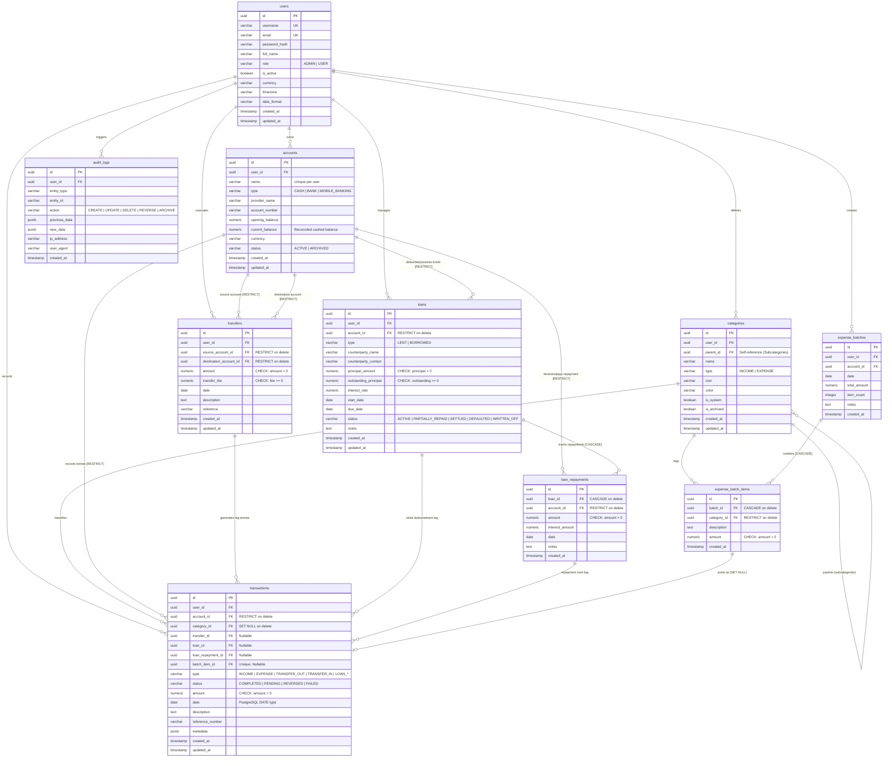

# Database Entity Relationship Diagram (ERD)
**Application:** AccountLedger.com  
**Engine:** PostgreSQL 16 (Neon Serverless)  
**Schema Date:** October 2026

---

## 1. Visual Entity Relationship Diagram (Mermaid)

---

## 2. Table-by-Table Schema Specification

### `users`
* **Constraints:**
  * `PK`: `id`
  * `UQ`: `username`
  * `UQ`: `email`
  * `CHECK`: `role IN ('ADMIN', 'USER')`
* **Indexes:**
  * `users_username_key` (`username`)
  * `users_email_key` (`email`)

### `accounts`
* **Constraints:**
  * `PK`: `id`
  * `FK`: `user_id` -> `users(id)` ON DELETE CASCADE
  * `UQ`: `(user_id, LOWER(name))` where `status = 'ACTIVE'`
  * `CHECK`: `type IN ('CASH', 'BANK', 'MOBILE_BANKING')`
  * `CHECK`: `status IN ('ACTIVE', 'ARCHIVED')`
* **Indexes:**
  * `idx_accounts_user_status` (`user_id`, `status`)
  * `uq_accounts_user_name` (`user_id`, `LOWER(name)`)

### `categories`
* **Constraints:**
  * `PK`: `id`
  * `FK`: `user_id` -> `users(id)` ON DELETE CASCADE
  * `FK`: `parent_id` -> `categories(id)` ON DELETE SET NULL
  * `UQ`: `(user_id, LOWER(name), type, COALESCE(parent_id, '00000000-0000-0000-0000-000000000000'::uuid))`
  * `CHECK`: `type IN ('INCOME', 'EXPENSE')`
  * `CHECK`: `parent_id IS NULL OR parent_id <> id` (Prevents self-parenting cycles)
* **Indexes:**
  * `idx_categories_user_type_archived` (`user_id`, `type`, `is_archived`)
  * `idx_categories_parent_id` (`parent_id`)

### `transactions`
* **Constraints:**
  * `PK`: `id`
  * `FK`: `user_id` -> `users(id)` ON DELETE CASCADE
  * `FK`: `account_id` -> `accounts(id)` ON DELETE RESTRICT
  * `FK`: `category_id` -> `categories(id)` ON DELETE SET NULL
  * `FK`: `transfer_id` -> `transfers(id)` ON DELETE SET NULL
  * `FK`: `loan_id` -> `loans(id)` ON DELETE SET NULL
  * `FK`: `loan_repayment_id` -> `loan_repayments(id)` ON DELETE SET NULL
  * `FK`: `batch_item_id` -> `expense_batch_items(id)` ON DELETE SET NULL
  * `CHECK`: `amount > 0`
  * `CHECK`: `type IN ('INCOME', 'EXPENSE', 'TRANSFER_OUT', 'TRANSFER_IN', 'LOAN_DISBURSEMENT_GIVEN', 'LOAN_DISBURSEMENT_RECEIVED', 'LOAN_REPAYMENT_RECEIVED', 'LOAN_REPAYMENT_MADE', 'OPENING_BALANCE')`
  * `CHECK`: `status IN ('COMPLETED', 'PENDING', 'REVERSED', 'FAILED')`
* **Indexes:**
  * `idx_transactions_user_date` (`user_id`, `date`)
  * `idx_transactions_user_account_date` (`user_id`, `account_id`, `date`)
  * `idx_transactions_user_type_date` (`user_id`, `type`, `date`)
  * `idx_transactions_user_category` (`user_id`, `category_id`)

### `transfers`
* **Constraints:**
  * `PK`: `id`
  * `FK`: `user_id` -> `users(id)` ON DELETE CASCADE
  * `FK`: `source_account_id` -> `accounts(id)` ON DELETE RESTRICT
  * `FK`: `destination_account_id` -> `accounts(id)` ON DELETE RESTRICT
  * `CHECK`: `source_account_id <> destination_account_id`
  * `CHECK`: `amount > 0`
  * `CHECK`: `transfer_fee >= 0`
* **Indexes:**
  * `idx_transfers_user_date` (`user_id`, `date`)
  * `idx_transfers_source` (`source_account_id`)
  * `idx_transfers_destination` (`destination_account_id`)

### `loans`
* **Constraints:**
  * `PK`: `id`
  * `FK`: `user_id` -> `users(id)` ON DELETE CASCADE
  * `FK`: `account_id` -> `accounts(id)` ON DELETE RESTRICT
  * `CHECK`: `type IN ('LENT', 'BORROWED')`
  * `CHECK`: `status IN ('ACTIVE', 'PARTIALLY_REPAID', 'SETTLED', 'DEFAULTED', 'WRITTEN_OFF')`
  * `CHECK`: `principal_amount > 0`
  * `CHECK`: `outstanding_principal >= 0`
* **Indexes:**
  * `idx_loans_user_type_status` (`user_id`, `type`, `status`)

### `loan_repayments`
* **Constraints:**
  * `PK`: `id`
  * `FK`: `loan_id` -> `loans(id)` ON DELETE CASCADE
  * `FK`: `account_id` -> `accounts(id)` ON DELETE RESTRICT
  * `CHECK`: `amount > 0`
  * `CHECK`: `interest_amount >= 0`
* **Indexes:**
  * `idx_repayments_loan_date` (`loan_id`, `date`)
